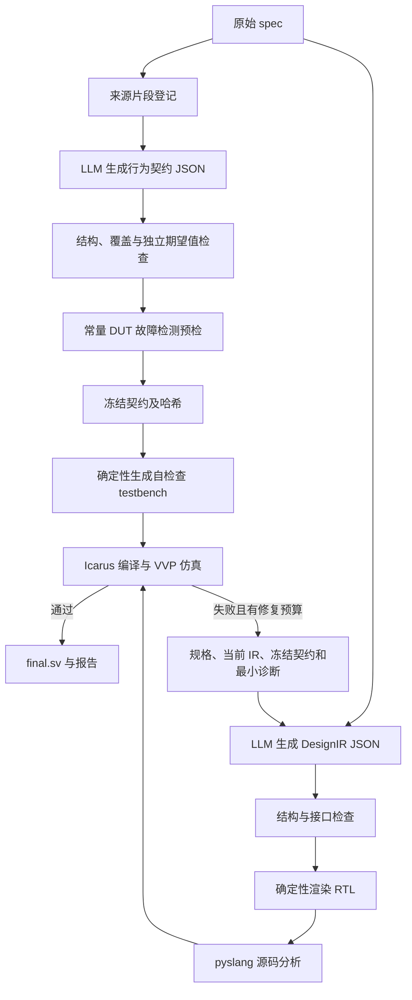

# JSON 设计与规格驱动验证：集成说明

## 新入口

`run_json_pipeline.py` 是本次集成后的主入口。旧 `closed_loop_enhanced_v2.py`、`generate_specs_batch.py` 和 `validator.py` 保留，分别用于历史闭环、直接生成对照和独立官方评测。运行旧脚本不会自动切到新方案。

在 PowerShell 中执行：

```powershell
cd "C:\Users\USER\OneDrive\文档\srtp\SRTP_LLM2RTL"
.\run_json.ps1 --check
.\run_json.ps1 --cases Prob005 Prob035 --max-repairs 5
```

第二条只检查环境，不调用 API；第三条实际调用已配置的 DeepSeek。也可直接用正常 Python 执行 `python run_json_pipeline.py --cases Prob005 --max-repairs 5`。

扫描全部规格的命令：

```powershell
.\run_json.ps1 --all --max-repairs 5
```

这并不保证当前 IR 能表达全部156题。建议先检查小批次结果。存储器数组、多时钟、模块实例等当前不支持，会记录为不支持或结构错误，而不是返回自由 RTL。只有新增经过测试的通用 IR 能力后才能扩大覆盖。

可通过 `--dataset` 指定只有 `*_prompt.txt` 的目录，通过 `--output` 指定一个尚不存在的结果目录。每次运行默认新建 `experiments/json_pipeline_时间戳`，不中途覆盖旧实验。

## 实际流程



这里的 DesignIR 是端口、寄存器、表达式、时钟、复位、优先级状态更新等数据结构；不是把 RTL 源码塞进 JSON 的 `systemverilog` 字段。原始生成和每次修复均只接受 DesignIR，RTL 由 Python 渲染。

初始 DesignIR 独立从 spec 生成，不以测试输出为唯一目标。契约分支只接收原始规格和来源编号。修复时可以读取冻结契约及其反例，但不能改契约。没有独立 Reviewer，不读取官方 `_ref.sv` 或 `_test.sv`。

契约最多一次结构补救。设计默认初始一次加最多5次修复，最多6个请求候选；结构错误也消耗候选预算，只有实际进入本地工具验证的才计入 validation_rounds。API异常单独记状态，不重复验证旧候选充数。相同RTL再次出现则 no_progress 停止。

## 关键模块

|文件|作用|
|---|---|
|rtl_json_pipeline/prompts.py|契约理解、DesignIR生成与修复提示词|
|source_registry.py|登记原始规格片段和引用编号|
|contract_schema.py / gates.py|契约、期望值来源、输出覆盖、设计接口门禁|
|design_ir.py|验证设计结构并确定性生成SystemVerilog|
|contract_compiler.py|通用行为操作编译为自检查testbench|
|analyzers.py|pyslang解析、绑定、类型和展开诊断|
|validation.py|Icarus/VVP调用、超时判定、首个失配与故障预检|
|pipeline.py|冻结契约、JSON修复循环、逐轮产物和错误归档|
|run_json_pipeline.py|单题/多题/全量入口与JSON、六列CSV汇总|

API使用现有 `llm_client.py` 和 `.env`；未复制压缩包密钥，也未覆盖现有模型配置。当前环境检查显示模型为 deepseek-v4-pro，未来以本机配置为准。

## 输出与计分

每题包括 spec.txt、source_registry.json、contract/attempt_XX、frozen_contract.json、verifier_preflight、iteration_NNN、summary.json。每轮保留请求、响应、设计JSON、渲染RTL、自建TB、pyslang诊断、编译和仿真日志。

- `module.sv`：最后一次成功渲染的候选，未必通过。
- `final.sv`：通过当前冻结契约验证的候选。
- 批次 `results.csv`：题号、类别、迭代次数、语法是否通过、功能是否通过、报错原因。功能栏明确写“通过（规格契约）”。
- 批次 `summary.json`：阶段状态、候选列表、通过数、耗时及已返回的token记录。连接失败没有返回的用量未知，不能当成免费。

官方基准正确率必须在新流程完全结束后另行运行 `validator.py`，选择新结果批次目录。其结果不回传模型。缺少候选的题会被旧validator跳过，全量统计仍须保留总题数及不支持/生成失败的题目，不能把内部契约通过率直接当作官方正确率。

## 已修复的压缩包问题与验证

1. 最新交接闭环仍返回含完整RTL字符串的JSON。本次改为接入真正的DesignIR渲染器。
2. 禁止期望值、模型变量和刺激表达式引用DUT输出；增加每个输出和场景的实际expect检查。
3. update_model同时读取旧状态后再赋值，修正原实现顺序更新问题。
4. 修复辅助组合信号不能引用已声明寄存器的检查顺序，并拒绝同一输出的组合/寄存双驱动。
5. 区分缺工具、编译错误、仿真超时、功能失败、API错误、不支持、无改善等状态；不把缺依赖计为硬件错误。
6. 修复阶段始终校验冻结契约哈希；最后预算用完不再生成未验证的额外候选。

本机安装并使用 pyslang 11.0.0、现有 D:/iverilog/bin/iverilog.exe 和 vvp.exe。pyslang安装到项目专用 `.deps/json_pipeline`，不改动系统Python；换机器可用 `python -m pip install -r requirements-json.txt`。

16项测试通过，包括：组合设计错误到正确的完整离线回放、真实pyslang/Icarus/VVP、计数器回绕故障、期望值自引用拒绝、RTL注入拒绝、模型变量同时更新、超时不误通过、API错误归档及原有6项回归测试。交接文档里的一行式合法模块已在本机进入功能仿真并按预期失败，没有绕过pyslang。

测试使用可控JSON响应回放，没有发起新的付费API实验，也没有重跑156题。因此现在验证的是工程接入与工具链，不是全量正确率提升。

## 当前边界

冻结与覆盖检查只能减少验证器错误，不能证明模型理解了全部规格。常量DUT预检也只是最小有效性检查，不是充分的变异覆盖。复位、边界、保持性目前由契约提示词要求，不是对所有硬件都可自动证明的门禁。JSON中的表达式仍需pyslang和Icarus检查；结构化生成不能保证零语法或语义错误。

最终通过契约验证的 RTL 现在默认追加 Yosys 通用综合评估，记录单元数量与组合逻辑深度；详见 [PPA使用说明.md](PPA使用说明.md)。实际器件 / 工艺的面积、时延和功耗尚未评估。功能验证使用 pyslang、Icarus Verilog 和 VVP；尚未接入 SymbiYosys、CIRCT 或形式化证明。
